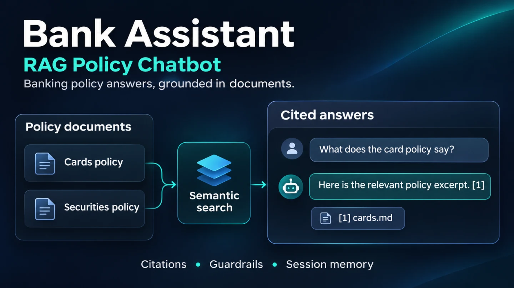

<div align="center">
  

  # Sapir Pirski — AI Engineer Portfolio

  **LLM engineering · GPU systems · RAG · evaluation · AI agents**

  A fast, responsive portfolio that turns public GitHub repositories into a curated visual showcase of production-minded AI and machine-learning work.

  [](https://sapir-pirski.github.io/)
  [](https://pages.github.com/)
  
  

  [View portfolio](https://sapir-pirski.github.io/) · [GitHub profile](https://github.com/sapir-pirski) · [LinkedIn](https://www.linkedin.com/in/sapir-pirski)
</div>

## Cover preview

<p align="center">
  
  
</p>

## What this portfolio highlights

- **LLM systems and agents** — RAG assistants, tool-using agents, RLHF, fine-tuning, and multimodal systems.
- **GPU engineering** — NVIDIA H100 inference, FP8 serving, CUDA Graphs, DDP, NCCL, and distributed training.
- **Evaluation and observability** — Ragas, SWE-bench, MLflow, Langfuse, Prometheus, and Grafana.
- **Applied machine learning** — NLP, text classification, genomic triage, and domain-specific applications.

## Experience

- Automatically loads current public repositories through the GitHub REST API.
- Applies curated project titles, artwork, categories, and five relevant skill tags per card.
- Provides category filtering for LLMs, GPU infrastructure, RAG/evaluation, ML/NLP, and applications.
- Uses consistent 16:9 frames with colorful project artwork on dark backgrounds.
- Introduces text-free illustrated artwork with a crisp white/teal HTML title on the Recruitment Assistant card.
- Displays current GitHub stars, repository update dates, and one GitHub link per card.
- Supports responsive phone, tablet, and desktop layouts.
- Includes accessible light and dark themes with saved user preference.
- Keeps covers static; each card's GitHub link opens in the current tab without a Details popup.

## Technology

| Layer | Tools |
| --- | --- |
| Structure | Semantic HTML5 |
| Styling | Modern CSS, responsive grid, CSS custom properties |
| Client logic | Vanilla JavaScript |
| Project data | GitHub REST API |
| Typography | Locally served Geist Sans and JetBrains Mono |
| Hosting | GitHub Pages |

## How it works

```text
GitHub REST API
      │
      ▼
Public repository metadata
      │
      ├── Category rules
      ├── Curated titles
      ├── Project artwork
      └── Skill mappings
      │
      ▼
Responsive portfolio cards
```

The site is intentionally build-free. Repository metadata stays current, while presentation details remain curated in the JSON catalog inside [`index.html`](index.html). Card rendering lives in [`portfolio.js`](portfolio.js).

## Run locally

```bash
git clone https://github.com/sapir-pirski/sapir-pirski.github.io.git
cd sapir-pirski.github.io
python3 -m http.server 8000
```

Open [http://localhost:8000](http://localhost:8000).

## Project structure

```text
.
├── assets/
│   ├── projects/       # Original artwork, optimized covers, and generation prompts
│   ├── fonts/          # Variable fonts and licenses
│   ├── screenshots/    # README previews
│   └── github-avatar.png
├── favicon.svg
├── index.html          # Page structure and curated project catalog
├── portfolio.js        # Cards, GitHub metadata, and filters
├── scripts/
│   └── generate-covers.py # Legacy SVG cover generator
├── styles.css          # Layout, themes, cards, and responsive behavior
└── README.md
```

## Updating project covers

Edit the JSON catalog in `index.html`. `coverImage` selects the card image and falls back to the retained original `detailImage`. Prefer optimized WebP assets; preserve the original artwork. Covers fill a 16:9 frame.

For illustrations with a clean title area, set `titleOverlay` to `true` and supply two `coverTitle` lines. The title is rendered in HTML, white on the first line and teal on the second. Generate artwork without text and reserve the upper third for that heading.

The Recruitment Assistant illustration was created with the built-in image generation tool. Its [final prompt](assets/projects/prompts/recruitment-illustration.txt) is retained with the asset. Other cards use the earlier colorful artwork, with large PNGs served as smaller WebP copies. The legacy SVG generator and assets are retained but are not used for the curated project covers.

## Deployment

The `main` branch is published directly with GitHub Pages. No framework build, package installation, or deployment service is required.

---

<div align="center">
  Built by <a href="https://github.com/sapir-pirski">Sapir Pirski</a>.
</div>
